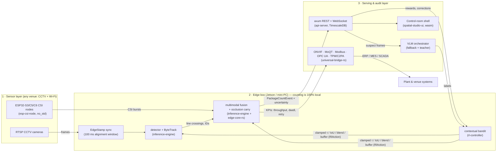
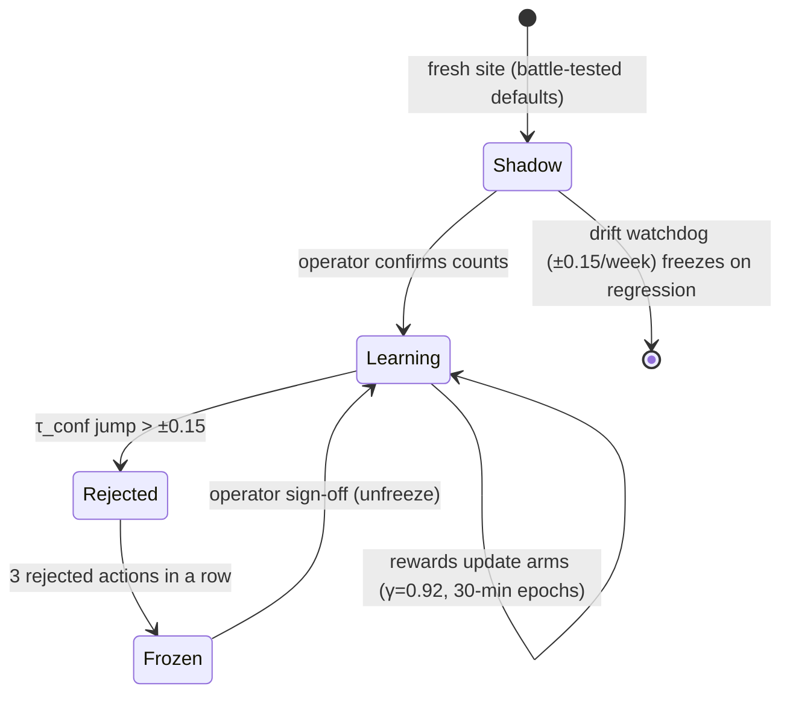

# Shado — Self-Correcting Multimodal Monitoring Engine

A production-grade platform that monitors shops, factories and other venues using synchronized **RTSP CCTV video** and **Wi-Fi Channel State Information (CSI)** radio signals, counts real-world events through **multimodal sensor fusion**, and self-corrects via a **human-in-the-loop Reinforcement Learning (RL) + active learning** feedback loop that fine-tunes the vision model overnight.

On top of that product, Shado ships the **Universal Multimodal Spatial Intelligence Platform** (docs/17): an industry-agnostic, privacy-first five-layer sensing/fusion/compliance stack where the factory is vertical #1 (QSR drive-through, retail-warehouse, and healthcare variants already have first-class contract templates). **If a venue has cameras and a Wi-Fi network, it ships.**

[](https://github.com/itsoumya-d/factory-monitor/actions/workflows/ci.yml)

**Status: implemented and green.** Phase 1–6 (ingestion → inference → RL → VLM → API → DB) plus Platform deliverables D1–D5 are merged to `main`; the workspace runs **432 tests** (+45 web vitest +5 Playwright E2E incl. the drag-to-fix label viewer), `cargo clippy -D warnings` clean, `cargo deny` clean (bans/sources/licenses/advisories), and CI passes **7/7 jobs** (lint, unit, integration w/ TimescaleDB, simulation, security, wasm, **web** incl. E2E).

---

## 1. What This System Does (Daily Lifecycle)

| Phase | Name | Summary |
|-------|------|---------|
| 1 | **Morning Boot & Calibration** | Detects lights-on (frame luminance trigger) + Wi-Fi CSI stabilization → captures reference snapshots → VLM layout diffing vs. yesterday's golden baseline → fires webhook calls to ERP/MES/alerting → recalibrates virtual counting lines (ROIs). |
| 2 | **Intraday Multimodal Counting** | ONNX detector (RF-DETR / YOLO26) → ByteTrack persistent IDs → virtual line-crossing counts. Wi-Fi CSI cross-verifies during occlusion, glare, steam, dust. Fused `PackageCountEvent` with confidence + uncertainty flags. |
| 3 | **EOD Human Feedback & RL Loop** | Visual business report (hourly throughput, bottleneck heatmaps, low-confidence windows). Operator corrections drive RL rewards → thresholds/fusion weights adjust within guardrail bounds → suspect frames go to the VLM for auto-labeling → nightly LoRA/ONNX fine-tune → hot-swap at next boot. |
| 4 | **Antifake audit battery** | Every sensor node runs the 7-control self-audit battery (output-prior bias, constant-input, subcarrier-shuffle, nearest-neighbor leak, temporal-only shortcut, 30 s empty-room baseline, door-swing negative control) through the `DiagnosableNode` trait; collapsed detectors are reported, never trusted. |

## 2. How It Works — the plumbing in one picture



Three hard guarantees, enforced by types and pinned by tests:

1. **RL can never blind the ML.** Every policy sample passes `RlAction::clamped` (τ ∈ [0.25, 0.85], IoU ∈ [0.25, 0.70], blend α+β=1 in [0.05, 0.95], buffer ∈ [20, 90]) before it reaches the fusion engine, tracker, or detector thresholds. `inference-engine/tests/rl_ml_pipeline.rs` drives a 64-venue-state sweep through **policy → action → fusion → tracker** and asserts every consumer stays in its runway.
2. **Reward is error-magnitude shaping.** `correction_reward(reported, actual) = −|actual − reported| / 100`: under-counts and over-counts are both penalties. One reward contract, shared by the live controller and the docs example.
3. **Sensors must be falsifiable.** Any CSI/camera node that cannot pass the 7-control anti-shortcut battery reports `NotRun`/`Fail` and is excluded from fusion.

### The self-correction loop (RL + active learning)



- **Arms:** one `LinearThompsonArm` per (dimension, bucket) — τ, IoU, vision-weight, track buffer, FP weight (all pre-bucketed inside guardrails).
- **Reward:** `correction_reward` (magnitude, docs-style example 1,485 counted vs. 1,420 actual = −0.65) + immediate ± shaping at 0.1×.
- **Safety:** veto on τ jumps, 3-veto freeze, operator pause/unfreeze, spend cap (`SHADO_DAILY_USD_CAP`), nightly fine-tune stays in shadow mode until it beats production.

## 3. Deploy Anywhere — universal environments

One typed contract (`monitoring-contract`), four first-class verticals; each template validates, passes the EU AI Act article-5 scan, scores **100 on the 5-check scorecard**, and feeds its native KPIs through the bridge to plant systems. All asserted in `spatial-studio-ui/tests/environments.rs` (the **any-CCTV+Wi-Fi gate**).

```mermaid
flowchart TB
    subgraph CAFE["☕ Café / QSR drive-through"]
        c_cam["lanes: 2–3 cams"] --> c_j["Jetson/mini-PC"]
        c_wifi["drive-through Wi-Fi mesh"] --> c_j
        c_j -->|"DropRetryRate,
        dwell@pickup"| c_out["Queue length, wait-time push to POS/POPAI"]
    end
    subgraph FACTORY["🏭 Factory floor"]
        f_cam["lines: 7–10 cams"] --> f_j["Jetson Orin"]
        f_wifi["line CSI nodes (S3/C5)"] --> f_j
        f_j -->|"CycleTimeDrift,
        throughput"| f_out["Andon + ERP/MES, SCADA
        (OPC UA / Modbus)"]
    end
    subgraph RETAIL["🛒 Retail warehouse"]
        r_cam["aisles: 4–6 cams"] --> r_j["mini-PC"]
        r_wifi["dock CSI nodes"] --> r_j
        r_j -->|"StockoutLatency,
        throughput"| r_out["Inventory + replenishment
        webhooks (HMAC)"]
    end
    subgraph HEALTH["🏥 Healthcare ward"]
        h_cam["corridors (aggregation-safe)"] --> h_j["Jetson"]
        h_wifi["ward CSI nodes"] --> h_j
        h_j -->|"FloorOccupancy
        (never 1:N biometrics)"| h_out["Occupancy dashboards,
        ε-DP station aggregation"]
    end
```



| Environment | Template | Native KPIs | Compliance notes |
|---|---|---|---|
| Factory floor | `manufacturing_line` | cycle-time drift, cumulative throughput | Andon via webhooks, SCADA via OPC UA tag plan |
| Café / QSR drive-through | `qsr_drivethru` | drop-retry rate, zone dwell | POS-safe privacy posture, dwell policies |
| Retail warehouse | `retail_warehouse` | stockout latency, throughput | SKU-shelf zones, no facial/person identifiers |
| Healthcare ward | `healthcare_nosocomial` | floor occupancy | No emotion inference, no 1:N biometrics, ε-DP aggregation — **privacy-first by construction** |

Bring your own vertical: the contract schema types targets, zones, guard lines, CSI rules, triggers, webhooks and KPIs — `validate()` enforces geometry bounds and prompt legality, so a new site is data, not code.

**Deployment baseline (what the stack assumes):** 802.11ac/ax Wi-Fi at the venue (CSI over 5 GHz), a PoE switch for the cameras, one edge box (NVIDIA Jetson class, NVDEC + TensorRT, or an Intel AX210 NIC mini-PC), and no line-of-sight requirement for the fusion path. Venue Wi-Fi client coexistence is normal — CSI comes from dedicated ESP32 nodes or the existing fabric.

## 4. Repo Layout (as shipped)

```
factory-monitor/
├── README.md
├── docs/                            # ← full build documentation (single source of truth)
│   ├── 01…15  product/architecture/stack/ingest/CSI/types/inference/RL/VLM/
│   │          api-server/DB schema/dashboard/deploy-ops/testing/build workflow
│   ├── 16-universal-platform.md     # charter of record for the universal platform
│   └── 17-universal-spatial-platform.md  # layer charter + deliverable order (D1–D5)
├── crates/                          # Rust workspace (13 crates, edition 2024)
│   ├── common-types/                # shared contracts: ids, events, feedback, bounds, traits
│   ├── ingestion-cctv/              # RTSP decode, luminance trigger, ring buffer
│   ├── ingestion-wifi/              # CSI parser, phase unwrap, FFT features
│   ├── inference-engine/            # ort sessions, detectors, ByteTrack, fusion
│   ├── rl-controller/               # contextual bandit policy, reward calc, guardrails
│   ├── vlm-orchestrator/            # VLM client: scene diff, root-cause, auto-label
│   ├── api-server/                  # axum REST + WebSocket, webhooks, TimescaleDB persistence
│   ├── monitoring-contract/         # universal typed rule schema + 4 vertical templates
│   ├── compliance-guard/            # EU AI Act Art 5(1)(f) block, Annex III safeguards, ε-DP
│   ├── esp-csi-node/                # no_std ESP32 CSI DSP + capability guardrails + audits
│   ├── edge-core-rs/                # fusion transformer seam, FIA occlusion recovery, 3-speed ctrl
│   ├── universal-bridge-rs/         # ONVIF verifier, MoQT seam, fieldbus codecs, TPM/C2PA, agents
│   ├── spatial-studio-ui/           # dioxus wasm shell: onboarding, ROI ledger, scorecard
│   └── api-server/migrations/0001_shado_core.sql   # Postgres+TimescaleDB schema
└── .github/workflows/ci.yml         # 6-job CI (lint / unit / integration / simulation / security / wasm)
```

## 5. The Universal Platform (docs/16→17) in One Paragraph

Same sensing stack, any vertical. `monitoring-contract` holds the typed rule schema (targets, zones, guard-lines, CSI rules, triggers, webhooks, KPIs) with validated templates for manufacturing, QSR drive-through, retail warehouse, and healthcare. `esp-csi-node` runs on-device as `no_std` firmware components (4-byte LTF strip, radix-2 FFT, Doppler velocity, recurrence plots, anti-fake audit battery) while the same DSP code compiles for host CI. `edge-core-rs` carries the cross-modal fusion seam, FIA occlusion recovery FSM, and the three-speed controller (prompt patch, clamped linear bandit, regression gate). `universal-bridge-rs` wires the outside world: deep ONVIF camera verification with clone transcripts, MoQT pub/sub rewind seam with HS256 tokens, Modbus `RegisterRepresentable` endian codecs, OPC UA tag plans, TPM 2.0 / C2PA provenance, and read-only MCP/rig agent tool contracts. `compliance-guard` is the privacy constitution (Art 5(1)(f) emotion lock, Annex III aggregation, ε-DP) applied contract-wide by `audit_contract`.

## 6. Quickstart

```bash
cargo test --workspace          # 431 tests, fully hermetic (no hardware, no docker)
cargo clippy --workspace --all-targets -- -D warnings
cargo fmt --all -- --check
cargo deny check                # licenses + advisories + bans + sources

cargo run -p api-server         # axum on 0.0.0.0:8080; falls back to an
                                # in-memory repo when DATABASE_URL is unset
rustup target add wasm32-unknown-unknown
cargo check --target wasm32-unknown-unknown -p spatial-studio-ui   # shell compile gate
```

Config (`crates/api-server/src/config.rs`), priority CLI > env > defaults:

| Env | Effect |
|-----|-------|
| `SHADO_BIND` | socket address, default `0.0.0.0:8080` |
| `DATABASE_URL` | Postgres/TimescaleDB; unset → in-memory repo |
| `SHADO_API_KEY` | ≥16 bytes; enables auth on mutating routes + snapshot exports |
| `WEBHOOK_SECRET` | ≥16 bytes; outbound HMAC-SHA256 signing (`docs/13 §7`) |
| `SHADO_DAILY_USD_CAP` | RL/VLM daily spend cap, default `15.0` |
| `SHADO_ALLOW_ORIGIN` | CORS origin, default `http://localhost:3000` |

## 7. Security Posture

- **Mutating routes + snapshot exports are key-gated** when `SHADO_API_KEY` is set — verified with a **constant-time byte comparison** (`ct_eq`); without the key the server keeps the documented trust-on-LAN posture.
- **Snapshot queries are hard-capped** at 500 rows server-side (no unbounded `jpeg_lowres` fetches).
- **Outbound webhooks** are HMAC-SHA256 with event-scoped idempotency keys; secrets are env-only, never persisted.
- **CI security job** runs the full `cargo deny` suite (licenses, advisory DB, dependency bans, source policy) and **gitleaks** secret scanning on every push.
- **OPC UA tags and Modbus registers carry only KPI scalars** — never raw frames or identities; NaN/∞ KPIs are rejected at the codec.
- No `.unwrap()`/`.expect()`/`unsafe` in production paths (clippy `-D warnings` enforces `unwrap_used`/`expect_used`; `unsafe_code = "forbid"` in all new platform crates).

## 8. CI — every push, both branches

`.github/workflows/ci.yml`:

| Job | What it runs |
|-----|--------------|
| lint | fmt check + clippy `-D warnings` |
| unit | `cargo test --workspace` (430 tests, hermetic) |
| integration | `--features itest` against a real Postgres/TimescaleDB service |
| simulation | oneshot HTTP round-trips through the real router |
| security | full `cargo deny` suite + gitleaks |
| wasm | `cargo check --target wasm32-unknown-unknown` for the spatial-studio shell |

Plus, in `--features itest` land, the acceptance suites: **`rl_ml_pipeline`** (RL→fusion→tracker sweep) and **`environments`** (4 verticals × contract × scorecard × KPI bridge).

## 9. Branching Model (strict)

- **`main`** — production-ready only. Code lands exclusively via `--no-ff` merge from `test-debug` after all gates pass.
- **`test-debug`** — the working branch. All implementation, tests, and CI runs happen here.

## 10. Non-Negotiable Engineering Rules

1. **No `.unwrap()`/`expect()` in production paths.** `thiserror` for library crates, errors surfaced at binary edges.
2. **RL guardrails are absolute:** `τ ∈ [0.25, 0.85]`, fusion weights `α, β ∈ [0.05, 0.95]` with `α + β = 1`, spend-capped. A bad human report can never blind the detector (docs/08 §4).
3. **EU AI Act compliance is a constructor, not a lint.** The emotion-recognition blocker is unconstructible at the type level; 1:N biometrics and raw frame persistence are prohibited by types, not reviews (docs/13 → `compliance-guard`).
4. **Time synchronization is mandatory:** CCTV frames and CSI bursts are edge-stamped and aligned in a 100 ms sliding window before fusion (docs/13 §3); the esp-crab dual-chip phase-sync enforces 100 ns @ 1 kHz.
5. **Every automated count is auditable:** predictions, sensor states, thresholds, and model version are persisted per event (docs/11).
6. **VLM is a fallback + teacher, not the primary counter.** Real-time counting is 100% local edge inference.
7. **Sensors must be falsifiable.** Any CSI/camera node that cannot run the anti-shortcut battery (docs/17 §3) reports `NotRun`/`Fail` and is excluded from fusion.

## 11. Hardware (edge nodes)

- Rust 2024 edition, pinned stable toolchain (`rust-toolchain.toml`)
- Wi-Fi sensing: **ESP32-S3 / C5 / C6** running the `esp-csi-node` firmware components (xtensa / riscv32 target-gated), or Intel **AX210/5300** NICs on mini-PCs
- Edge GPU: NVIDIA NVDEC (GStreamer) + TensorRT/CUDA execution providers for `ort`

## 12. Quick Doc Navigation

| I want to… | Read |
|---|---|
| Understand the product & users | `docs/01-product-overview.md` |
| See how crates fit together | `docs/02-system-architecture.md` |
| Check crate/pin choices | `docs/03-technology-stack.md` |
| Build the CCTV pipeline | `docs/04-cctv-ingestion.md` |
| Build the Wi-Fi CSI pipeline | `docs/05-wifi-sensing.md` |
| Implement core types/traits | `docs/06-core-data-structures.md` |
| Implement detection/tracking/fusion | `docs/07-inference-engine.md` |
| Implement the RL loop safely | `docs/08-rl-controller.md` |
| Integrate VLM APIs | `docs/09-vlm-orchestrator.md` |
| Build the axum API | `docs/10-api-server.md` |
| Create DB migrations | `docs/11-database-schema.md` |
| Build the Next.js dashboard | `docs/12-dashboard-spec.md` |
| Deploy hardware & ops | `docs/13-deployment-ops.md` |
| Test & debug | `docs/14-testing-and-debugging.md` |
| Follow build/merge workflow | `docs/15-build-workflow.md` |
| Read the universal-platform charter | `docs/16-universal-platform.md` |
| Read the 5-layer platform spec | `docs/17-universal-spatial-platform.md` |
