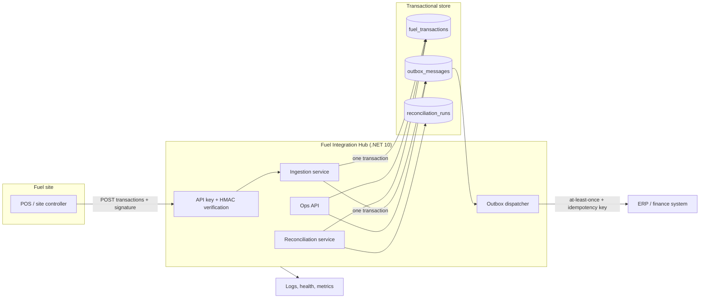

# Fuel Integration Hub

A production-grade .NET 10 reference service for the integration layer between fuel-site systems, an ERP, and operations teams. It is intentionally built around the work in Octane Systems' Senior Software Developer role: C# and .NET, advanced SQL and schema design, API and third-party integration, CI/CD, cloud deployment, mentoring standards, and AI-assisted development.

The service ingests forecourt transactions with idempotency and HMAC verification, writes an outbox message in the same database transaction, delivers events to the ERP with bounded retries and dead-letter handling, and reconciles site litres against ERP litres with an explicit variance threshold.

[](https://github.com/itsoumya-d/factory-monitor/actions/workflows/dotnet-ci.yml)

## Why this maps to the role

| Role requirement | Evidence in this service |
|---|---|
| Strong C# and .NET | .NET 10, ASP.NET Core Minimal APIs, typed domain model, EF Core 10, xUnit, `TreatWarningsAsErrors` |
| Advanced SQL and database design | Normalised schema, unique and covering indexes, check constraints, concurrency tokens, transactional outbox, reconciliation aggregates |
| API and integration development | REST API, API-key authentication, HMAC-SHA256 webhook verification, idempotency keys, ERP adapter, retry/backoff, dead-letter queue |
| CI/CD and modern DevOps | GitHub Actions restore, format, build, test, coverage, vulnerability audit, publish artifact, Dockerfile, Dependabot |
| Cloud environment | Azure Container Apps, Azure Files persistence, Log Analytics, Bicep infrastructure, health and readiness probes |
| Mentoring and technical leadership | ADRs, engineering standards, runbook, PR checklist, AI-agent instructions, explicit design trade-offs |
| AI-assisted development | `AGENTS.md`, Copilot instructions, verification-first workflow, prompt and review guardrails |
| Fuel/ERP domain | Site, dispenser, product, fuel transaction, litre reconciliation, ERP outbox event |

## Architecture



### Ingestion path

1. The client sends `POST /api/v1/sites/{siteCode}/transactions` with `X-Api-Key`, `X-Octane-Timestamp`, and `X-Octane-Signature`.
2. The middleware verifies the HMAC over `timestamp + "\n" + rawBody` and rejects a clock skew above the configured window.
3. The domain validates the site, dispenser, product, litres, price, timestamp, and payment method.
4. The service writes the transaction and an outbox message in one `SaveChanges` transaction.
5. A retry returns `200 OK` with the original transaction instead of creating a duplicate.

### Delivery path

The outbox dispatcher claims pending messages, sends them to the ERP adapter, and marks them sent. Failures increment the attempt count and schedule an exponential backoff of 2, 4, 8, 16, ... seconds, capped at five minutes. After the configured maximum attempts the message becomes `DeadLetter` and can be requeued through the ops endpoint. The ERP contract is at-least-once; the idempotency key is `tx:{siteCode}:{externalId}`.

### Reconciliation path

The reconciliation service aggregates recorded litres for a site and period, compares them with ERP litres, calculates absolute variance and percentage variance, and persists a `Balanced` or `VarianceDetected` run. The threshold is per request, so finance and operations can apply a tighter bound during month-end close.

## API

| Method | Route | Purpose |
|---|---|---|
| `POST` | `/api/v1/sites/{siteCode}/transactions` | Ingest one transaction; HMAC required |
| `POST` | `/api/v1/sites/{siteCode}/transactions/batch` | Ingest up to 500 transactions; HMAC required |
| `GET` | `/api/v1/sites/{siteCode}/transactions` | Paged transaction query |
| `POST` | `/api/v1/sites/{siteCode}/reconciliations` | Reconcile site litres against ERP litres |
| `GET` | `/api/v1/sites/{siteCode}/reconciliations` | List recent reconciliation runs |
| `GET` | `/api/v1/sites` | List sites and dispenser counts |
| `GET` | `/api/v1/ops/outbox` | Inspect pending, sent, or dead-letter messages |
| `POST` | `/api/v1/ops/outbox/{id}/retry` | Requeue a dead-letter message |
| `GET` | `/api/v1/ops/metrics` | Operational counters |
| `GET` | `/health` | Liveness |
| `GET` | `/health/ready` | Readiness |
| `GET` | `/openapi/v1.json` | OpenAPI document |

Every `/api` route requires `X-Api-Key`. The two transaction POST routes additionally require the HMAC headers.

## Quickstart

Prerequisites: .NET 10 SDK.

```bash
cd dotnet
dotnet restore FuelIntegrationHub.slnx
dotnet build FuelIntegrationHub.slnx -c Release
dotnet test FuelIntegrationHub.slnx -c Release
ASPNETCORE_ENVIRONMENT=Development dotnet run --project src/FuelIntegrationHub.Api
```

The development profile listens on `http://localhost:5085`. It creates and seeds a local SQLite database with two sites, two products, and three dispensers. Development-only credentials are in `appsettings.Development.json`; replace them through environment variables outside local development.

### Send a signed transaction

```bash
BODY='{"externalId":"TX-DEMO-001","occurredAt":"2026-10-28T08:00:00Z","dispenserCode":"D1","productCode":"91","litres":40,"unitPrice":2.45,"paymentMethod":"FleetCard"}'
TS=$(date +%s)
SIG=$(printf "%s\n%s" "$TS" "$BODY" | openssl dgst -sha256 -hmac "dev-only-webhook-secret-32-characters-0001" -hex | sed 's/^.* //')

curl -sS -X POST "http://localhost:5085/api/v1/sites/AKL-01/transactions" \
  -H "Content-Type: application/json" \
  -H "X-Api-Key: dev-only-api-key-32-characters-0001" \
  -H "X-Octane-Timestamp: $TS" \
  -H "X-Octane-Signature: sha256=$SIG" \
  -d "$BODY"
```

### Reconcile

```bash
curl -sS -X POST "http://localhost:5085/api/v1/sites/AKL-01/reconciliations" \
  -H "Content-Type: application/json" \
  -H "X-Api-Key: dev-only-api-key-32-characters-0001" \
  -d '{"periodStart":"2026-10-28T00:00:00Z","periodEnd":"2026-10-29T00:00:00Z","erpLitres":39.8,"thresholdPercent":0.5}'
```

## Database design

| Table | Key design decision |
|---|---|
| `sites` | Unique site code; optimistic concurrency `version`; inactive sites cannot accept transactions |
| `products` | Unique product code; unit and lifecycle state |
| `dispensers` | Unique `(site_id, code)`; foreign keys to site and product; restriction prevents deleting referenced products |
| `fuel_transactions` | Unique `(site_id, external_id)` is the idempotency boundary; index `(site_id, occurred_at)` serves time-range queries; check constraints bound litres, price, and total; append-only status |
| `outbox_messages` | Unique idempotency key; index `(status, next_attempt_at)` for the dispatcher; attempts, next attempt, processed timestamp, and last error |
| `reconciliation_runs` | Period checks; indexed by `(site_id, period_end)`; stores the threshold used so historical decisions remain explainable |

`DateTimeOffset` values are stored as Unix milliseconds so range predicates translate correctly across SQLite and relational providers. Decimal columns use explicit precision and SQLite-safe `CAST(... AS REAL)` bounds in check constraints. The EF model is provider-agnostic; the deployment template uses SQLite on Azure Files for a low-cost demo, and the same model can be moved to Azure SQL or PostgreSQL before horizontal scale.

## Tests

```bash
dotnet test FuelIntegrationHub.slnx -c Release
```

31 tests: 16 domain tests and 15 API integration tests. The API suite uses `WebApplicationFactory`, a shared in-memory SQLite connection, real authentication, real HMAC verification, real EF Core persistence, and the simulated ERP adapter. It covers idempotency, invalid signatures, missing API keys, unknown sites, domain validation, batch partial success, paging, reconciliation variance, outbox delivery, dead-letter requeue, metrics, and public health checks.

## Benchmarks

Measured on macOS arm64 with .NET 10.0.14, a file-backed SQLite database, and 50,000 transactions with one outbox message per transaction:

| Operation | Work | Elapsed | Throughput |
|---|---:|---:|---:|
| Batch ingestion | 50,000 transactions | 10,464 ms | 4,778 tx/s |
| Reconciliation | 50,000 rows aggregated | 158 ms | 316,884 rows/s |
| Paged query | 50 rows (page 101) | 10.72 ms | 0.214 ms/row |

Re-run with:

```bash
dotnet run --project bench/FuelIntegrationHub.Benchmarks -c Release -- 50000
```

These are local engineering measurements, not a production capacity plan.

## CI/CD

The `.github/workflows/dotnet-ci.yml` workflow runs on changes under `dotnet/`:

1. Restore.
2. `dotnet format --verify-no-changes`.
3. Release build with warnings treated as errors.
4. Tests with XPlat coverage and TRX output.
5. `dotnet list package --vulnerable --include-transitive`.
6. Publish the API artifact.
7. Upload test and coverage artifacts.

Dependabot keeps NuGet and GitHub Actions current. The Dockerfile is a multi-stage .NET 10 build and is suitable for Container Apps, AKS, or any OCI runtime.

## Azure deployment

```bash
cd dotnet
az acr build --registry <acr> --image fuel-integration-hub:latest --file src/FuelIntegrationHub.Api/Dockerfile .
az deployment group create \
  --resource-group rg-fuel-integration \
  --template-file deploy/main.bicep \
  --parameters containerImage=<acr>.azurecr.io/fuel-integration-hub:latest \
               apiKey='<secret>' webhookSecret='<secret>'
```

The Bicep template creates a Log Analytics workspace, a Storage account and Azure Files share, a Container Apps environment, and the API container app with liveness and readiness probes. It pins one replica because SQLite is a single-writer store. See [`deploy/README.md`](deploy/README.md).

## Security

- API keys are compared with `CryptographicOperations.FixedTimeEquals`.
- Inbound webhooks use HMAC-SHA256 over the timestamp and raw body, with a configurable clock-skew window.
- The signature check uses the raw request body; JSON reserialization is never trusted.
- Transaction and outbox writes share one database transaction.
- Idempotency is enforced by a unique database index, not only an application check.
- Secrets are configuration/environment values and are never committed.
- The container runs as the .NET 10 ASP.NET runtime image; no build SDK ships in the runtime image.
- CI runs a transitive NuGet vulnerability audit.
- The API returns RFC 9457 Problem Details without leaking stack traces.

Threat model and operational procedures are in [`SECURITY.md`](SECURITY.md) and [`docs/runbook.md`](docs/runbook.md).

## AI-assisted development

This repository treats AI tools as engineering accelerators with explicit guardrails:

- [`AGENTS.md`](AGENTS.md) defines the build/test loop, architecture boundaries, and non-negotiable rules for coding agents.
- [`.github/copilot-instructions.md`](.github/copilot-instructions.md) gives GitHub Copilot the same context.
- [`docs/ai-assisted-development.md`](docs/ai-assisted-development.md) documents the workflow: write or update a failing test, generate a bounded change, run the full suite, review the diff, and never let generated code bypass validation, authentication, or logging rules.
- AI-generated changes are reviewed like any other change. The repository is the source of truth, not the prompt.

## Repository layout

```text
dotnet/
├── src/
│   ├── FuelIntegrationHub.Domain/          # entities, invariants, reconciliation rules
│   ├── FuelIntegrationHub.Infrastructure/  # EF Core, outbox, ERP adapters, services
│   └── FuelIntegrationHub.Api/             # Minimal API, auth, HMAC, endpoints, Dockerfile
├── tests/
│   ├── FuelIntegrationHub.Domain.Tests/
│   └── FuelIntegrationHub.Api.Tests/
├── bench/FuelIntegrationHub.Benchmarks/    # repeatable local benchmark
├── deploy/                                 # Azure Container Apps Bicep
├── docs/                                   # ADRs, runbook, standards, AI workflow
├── AGENTS.md
├── SECURITY.md
└── FuelIntegrationHub.slnx
```

## Deliberate trade-offs

- SQLite keeps the demo runnable with zero external infrastructure and makes the benchmark reproducible. It is not the production target for a multi-replica ERP integration service.
- Minimal APIs keep the integration surface small and explicit. ASP.NET MVC is a reasonable alternative if the team already standardises on controllers.
- The ERP adapter is simulated by default so reviewers can run the full flow without credentials. Set `Erp__Mode=Http` and `Erp__BaseUrl` to point at a real endpoint.
- The outbox is at-least-once. The ERP must enforce the idempotency key; the service does not claim exactly-once delivery.
- The service is a focused integration slice, not the full Octane ERP. It demonstrates the engineering patterns the role needs: safe ingestion, reliable integration, reconciliation, observability, and maintainable delivery.
