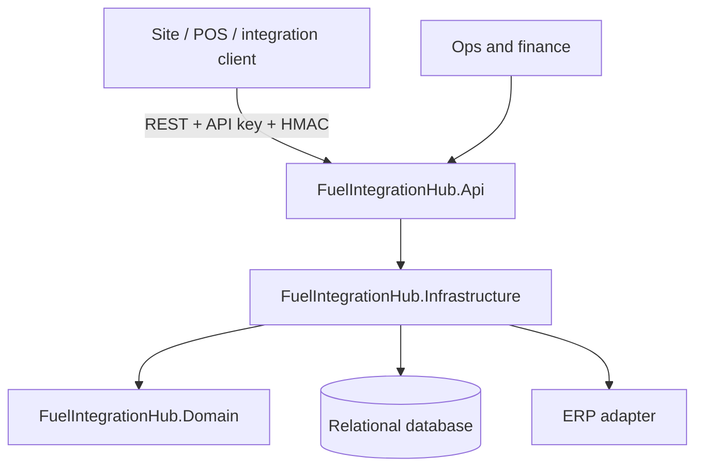

# Architecture

## Context

Fuel sites produce high-volume transaction records that must reach an ERP without duplicates, gaps, or silent divergence. The integration layer sits between site/POS systems and the ERP, so it must be strict at the edge and predictable under retry.

## Components

### API

The API is a stateless HTTP edge. It owns authentication, HMAC verification, request contracts, HTTP status mapping, health checks, and OpenAPI. It does not contain business invariants.

### Domain

The domain owns the rules that must hold regardless of transport:

- a transaction belongs to an active site and an active dispenser configured for the product;
- litres, unit price, total, and timestamp are bounded;
- reconciliation variance is calculated with explicit rounding and threshold semantics;
- outbox retry state transitions are explicit and testable.

### Infrastructure

Infrastructure owns EF Core mappings, database initialization, application services, the outbox processor, and ERP adapters. The write service is the only place that creates a transaction and its outbox message together.

### Database

The relational model is normalised and uses database constraints as the final guard:

- unique site code and product code;
- unique dispenser code per site;
- unique external transaction id per site;
- time-range index for queries;
- check constraints on litres, price, total, period, and threshold;
- optimistic concurrency on mutable site records;
- outbox index on `(status, next_attempt_at)`.

## Consistency model

The transaction write and outbox enqueue are atomic. ERP delivery is at-least-once. The ERP must use the supplied idempotency key to avoid duplicate postings. The service never claims exactly-once delivery across two systems.

## Scaling

The API is stateless and can scale horizontally. The outbox worker can run multiple replicas if the database supports safe claim semantics; the reference implementation keeps one worker and documents the claim boundary. SQLite is single-writer, so the Azure deployment pins one replica. Move to Azure SQL or PostgreSQL before increasing replicas.

## Failure modes

| Failure | Behaviour |
|---|---|
| Duplicate external id | Return the original transaction with `200 OK`; no second outbox message |
| Concurrent duplicate insert | Database unique index rejects the loser; the service re-reads and returns the winner |
| Invalid signature | `401` before the endpoint executes |
| Unknown site/dispenser | `404` or `400` Problem Details |
| ERP timeout | Outbox remains pending with exponential backoff |
| Repeated ERP failure | Dead-letter after maximum attempts; ops can requeue |
| Reconciliation variance | Persisted run with `VarianceDetected`; finance can investigate |
| Database unavailable | Readiness fails; requests return `500` rather than partial writes |

## Decisions

See [`adr/0001-modular-monolith.md`](adr/0001-modular-monolith.md) and [`adr/0002-transactional-outbox.md`](adr/0002-transactional-outbox.md).
